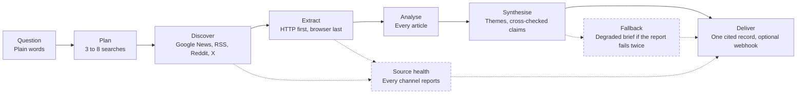

# News Intelligence Agent

Design notes for the AI News Research Agent on the Apify Store. Ask a news question in plain English and get back a cited brief built from Google News, publisher RSS feeds, Reddit and X. The source code is private. The Actor is public: [run it on the Apify Store](https://apify.com/kay_abraham/news-intelligence-agent).

## What it does

It has two modes.

- **Intelligence brief** (the default). Claude plans the research, the Actor finds and extracts the articles, and Claude reads every one and writes the brief. A brief holds an executive summary with citation markers, the five most important headlines, 3 to 7 themes, anomalies, claims backed by several sources and claims that rest on one, the people, companies and countries mentioned most, the overall mood, three follow-up questions and a full markdown report. It comes in any of 13 languages.
- **Articles only.** The Actor skips the model. It searches Google News and publisher RSS feeds, drops duplicates and off-topic items, pulls the full text and returns one record with every article.

## Who it's for

- Government and policy teams tracking global events
- Analysts who need a digest before a meeting
- PR, brand and crisis teams watching coverage of a company or a product
- Investor research on signals across markets
- Journalists tracking patterns across many sources
- AI agents and pipelines that need fresh, clean news text

## How to run it

1. Open [the Actor on the Apify Store](https://apify.com/kay_abraham/news-intelligence-agent).
2. Type your question.
3. Press Start.

Every other field has a default. A brief takes 3 to 6 minutes, and articles only takes 1 to 3.

From an AI agent, an MCP client or the API, call `kay_abraham/news-intelligence-agent` with `{ "userQuery": "your question" }`. Add `"outputMode": "articles"` for raw articles. There's no key to paste.

To run it on a schedule, point an Apify schedule at the Actor and set `webhookUrl` to a chat webhook. The markdown report arrives in the channel when the run finishes.

## Architecture

Dashed lines and dashed boxes are guards.

1. **Plan.** Claude turns the question into 3 to 8 search queries, a source list balanced across regions, and the criteria for impact and anomalies. Articles mode builds the queries from the question and tags, with no model.
2. **Discover.** Google News per query, publisher RSS feeds, and Reddit and X when switched on. The Actor drops duplicates and ranks the rest: sources a crawler can read go first, and paywalled publishers go last and fill at most a fifth of the queue.
3. **Extract.** Apify's Website Content Crawler pulls the readable text over plain HTTP. Four large publishers go to dedicated extractors in parallel. If coverage comes back short, a top-up wave extracts the reserve candidates, and a headless browser is the last resort for pages built in JavaScript.
4. **Analyse.** Claude reads every article: summary, keywords, entities, sentiment, impact score, anomaly flag and quotes. It translates non-English text when asked.
5. **Synthesise.** Claude clusters themes, checks claims across sources, ranks headlines and key actors, and writes the markdown report.
6. **Deliver.** One record goes to the dataset, plus an optional POST to your webhook.

## Reliability rules

The Actor runs on one rule: a missing or failing source must announce itself.

- **Three discovery channels and two extraction stacks.** Google News, publisher RSS feeds and a web-search fallback find the candidates. Reddit and X add signal when switched on. Website Content Crawler reads pages over plain HTTP first and in a headless browser second.
- **One honest retry per child call** on a transient failure, and zero retries on a permission error.
- **Source health in every record.** `sourceHealth` lists each channel and extractor with its status and counts, for example `google-news ok (8) · rss ok (81) · reddit off · website-content-crawler (http) ok 36/39`. `warnings` holds whatever didn't answer, and `allSourcesAnswered` is the one flag to alert on.
- **A brief arrives even when the model stumbles.** If the final report fails twice, the run writes a degraded brief from the per-article analysis, marks the record `degraded: true` and explains why.
- **Bounded runs.** Max articles, a model spend cap and a run timeout bound every run. The Actor itself peaks under 100 MB.
- **Limited permissions.** The Actor reads its own input, writes its own dataset and key-value store, and starts other limited-permission Actors. That's why an agent or MCP client can call it without an approval step.

Limits: it doesn't break paywalls or crawl a site you name, and Reddit and X depend on third-party scrapers.

## Pricing

It's pay per event, billed to your Apify account. A run costs three parts:

1. **The Actor's events.** $0.10 when a run starts, plus one "brief or article pack delivered" event per run: $0.80 on a free account, $0.70 on Starter, $0.60 on Scale and $0.50 on Business and above. That's $0.90 per brief on a free account and $0.60 on Business. The Store's Pricing tab shows the current numbers.
2. **Child Actors.** Google News search, the RSS reader, Website Content Crawler, and the Reddit and X scrapers when you turn them on. They bill as your own usage.
3. **Model tokens.** A few cents per brief on Haiku 5.5 and around 10 to 40 cents on Sonnet 5.5, depending on the number of articles. Articles mode uses zero tokens.

By default Claude runs through Apify's model proxy and the tokens bill to your Apify account. You can paste your own Claude API key, and then the tokens bill to that account. Free accounts get Haiku 5.5 unless you pick a model, because the proxy charges them a higher token rate. Every brief record carries `billing` and `costEstimateUsd`, so you can see what each run spent on the model.

## Changelog

- **0.4.18 (October 2026).** Reliability pass: every source and extractor reports its status in `sourceHealth`, one honest retry per child call, a degraded brief when the model can't write the report, and a custom model id field so new Claude releases need no update.
- **0.4.15 (October 2026).** Claude 5.5 models: Sonnet 5.5 by default, Haiku 5.5 for free accounts, Opus 5.5 for the most thorough briefs.
- **0.4 (October 2026).** Zero API keys, with the model running through Apify's proxy. Limited permissions, so agents and MCP clients can call it. A new articles-only mode. Website Content Crawler for extraction. Readable sources ranked first and paywalled publishers capped. A top-up wave for short coverage. Default memory lowered to 1 GB.
- **0.3.** Pay-per-event pricing, source tiers, quote extraction and anomaly detection.

## Source

The source code is private, and this repo holds the design notes. The Actor's page on my site is [kayabraham.com/machines/news-agent](https://kayabraham.com/machines/news-agent/), and my other machines are in [kay-abraham/machines](https://github.com/kay-abraham/machines).
